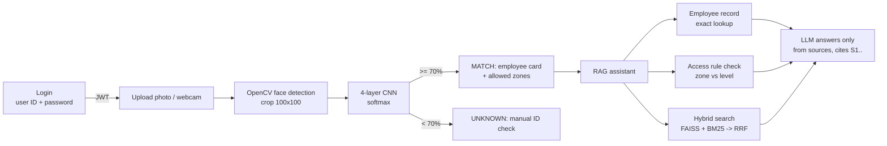

# Employee Verification Portal: Face Recognition + RAG

A full-stack company portal. A security officer signs in, uploads or captures a photo, and the
system recognises the employee with a **CNN (Keras)**, shows their details, access level and allowed
zones, and answers policy questions about them with a **RAG assistant** (LangChain + FAISS + BM25 + LLM)
that cites its sources.

**Live demo:** https://YOUR-HF-USERNAME-employee-verification-portal.hf.space  
**Demo login:** user ID `demo` · password `YOUR-DEMO-PASSWORD` (security role: verify + assistant)

> The company ("Orion Nexus Technologies") and its policies are fictional, written for this demo.
> The demo sleeps when unused; the first visit can take 2–3 minutes to wake up and train.

## Features

| Area | What it does |
|---|---|
| **Login** | User ID + password, bcrypt-hashed passwords, JWT tokens (8 h), roles (admin / security), lockout after 5 wrong attempts |
| **Enrolment** | Admin uploads a **folder of photos per person**, or **one zip with a folder per person**. Every photo is face-detected (OpenCV), cropped to 100×100 and saved; bad photos are reported |
| **Training** | 4-layer CNN with built-in normalisation and augmentation (flip, rotation, zoom, shift), stratified 80/20 split, class weights, early stopping. Runs in the background with live progress |
| **Evaluation** | Accuracy, precision, recall, F1 (macro and per person), confusion matrix, accuracy curve |
| **Verification** | Upload or webcam → face box → top-3 predictions → **MATCH / UNKNOWN / NO_FACE**. Below 70% confidence the result is UNKNOWN, not a wrong name |
| **Employee card** | Photo, code, department, access level, status, shift, manager, **allowed zones**, warnings for On Leave / Suspended / Exited |
| **RAG assistant** | Ask "Can this employee enter the server room?" → employee record + rule-based access check + hybrid retrieval over policies → LLM answer with [S1] citations |
| **Knowledge base** | 5 policy documents included; admins can upload more (.md, .txt, .pdf). The index rebuilds automatically |
| **Audit** | Every verification is logged (who checked, when, result, confidence) |

## How it works



**Admin flow:** upload zip/folders → faces detected and cropped → train → check metrics → the model
is hot-swapped (no restart needed).

## Tech stack

- **Frontend:** React 19, Vite, React Router (no UI framework; charts are hand-drawn SVG)
- **Backend:** FastAPI, SQLAlchemy (SQLite by default; set `DATABASE_URL` for PostgreSQL)
- **Vision:** TensorFlow/Keras CNN, OpenCV Haar cascade face detection
- **RAG:** LangChain, FAISS vector store, BM25, Reciprocal Rank Fusion, Groq / Gemini / OpenAI LLMs
- **Auth:** bcrypt, PyJWT, OAuth2 password flow
- **Tests:** pytest (30 tests), RAG retrieval evaluation script
- **Deploy:** one Docker image (FastAPI serves the built React app)

## Project structure

```
face-portal/
├── backend/
│   ├── app/
│   │   ├── main.py              FastAPI app, serves the React build in production
│   │   ├── config.py            all settings (env / .env)
│   │   ├── db.py                tables: users, employees, verification_logs, training_runs
│   │   ├── security.py          bcrypt + JWT + role checks
│   │   ├── seed.py              optional demo seeding (photo zip + demo login) on start-up
│   │   ├── face/
│   │   │   ├── detector.py      face detection + cropping (same code for training and verification)
│   │   │   ├── dataset.py       folder / zip upload -> data/faces/<person>/*.jpg
│   │   │   ├── model.py         the CNN, training, metrics
│   │   │   └── service.py       loaded model, background training, prediction, UNKNOWN rule
│   │   ├── rag/
│   │   │   ├── documents.py     load policies + employee profiles, chunking
│   │   │   ├── embeddings.py    tfidf / fastembed / huggingface embeddings
│   │   │   ├── bm25.py          BM25 keyword search + Reciprocal Rank Fusion
│   │   │   ├── index.py         FAISS + BM25 index, hybrid search
│   │   │   ├── llm.py           Groq / Gemini / OpenAI
│   │   │   └── assistant.py     retrieval -> prompt -> answer with citations (+ no-LLM fallback)
│   │   └── routers/             auth, employees, recognition, knowledge, admin
│   ├── knowledge_base/policies/ the 5 company policy documents
│   ├── scripts/manage.py        CLI: import zip/folder, set details, train, add users
│   ├── scripts/eval_rag.py      retrieval evaluation (Hit@k, MRR)
│   ├── eval/                    labelled questions + latest results
│   └── tests/                   pytest suite
├── frontend/src/                React pages and components
├── Dockerfile, docker-compose.yml
├── deploy/huggingface/README.md Space config (used only on Hugging Face)
├── DEPLOY.md                    step-by-step live demo deployment
└── INTERVIEW_GUIDE.md           how to explain the project
```

## Run it locally

You need **Python 3.11 or 3.12** and **Node 20+**.

**1. Backend** (terminal 1)

```bash
cd backend
python -m venv .venv
.venv\Scripts\activate            # Windows   (macOS/Linux: source .venv/bin/activate)
pip install -r requirements-dev.txt
copy .env.example .env            # Windows   (macOS/Linux: cp .env.example .env)
# open .env: set JWT_SECRET, ADMIN_PASSWORD and GROQ_API_KEY (free at console.groq.com/keys)
uvicorn app.main:app --reload
```

The API runs at http://localhost:8000. Interactive API docs are at http://localhost:8000/docs.

**2. Frontend** (terminal 2)

```bash
cd frontend
npm install
npm run dev
```

Open http://localhost:5173 and sign in with `ADMIN_USER_ID` / `ADMIN_PASSWORD` from `.env`
(default `admin` / `Admin@123`, change it).

**3. Add your people and train**

1. Put the photos in one folder per person and zip it:
   ```
   project 1/
     harshal/ img1.jpg img2.jpg ...
     kishan/  img1.jpg ...
   ```
   Use **10+ photos per person**: different angles, lighting and expressions, one face per photo.
2. **Enrol & Train → Upload zip of person folders.** The report shows how many faces were saved or skipped.
3. **Employees →** fill in each person's details (department, access level, status ...), or load the
   sample details: `python -m scripts.manage details scripts/employees.sample.json`
4. **Enrol & Train → Train model.** Wait for the metrics.
5. **Verify →** upload a new photo of someone, or use the webcam.

Command-line alternative:

```bash
python -m scripts.manage import-zip "path/to/project 1.zip"
python -m scripts.manage details scripts/employees.sample.json
python -m scripts.manage train --epochs 40
python -m scripts.manage add-user security1 "Gate Security" Security@123 --role security
```

## Tests and evaluation

```bash
cd backend
pytest                          # 30 tests: auth, roles, enrolment, training, verify, RAG, fallbacks
python -m scripts.eval_rag      # retrieval quality: vector vs BM25 vs hybrid
```

Latest retrieval results (28 labelled questions, TF-IDF embeddings, k = 4):

| Retriever | Hit@1 | Hit@4 | MRR |
|---|---|---|---|
| Vector (FAISS) | 57% | 75% | 0.64 |
| BM25 | 57% | 79% | 0.66 |
| **Hybrid (RRF)** | 57% | **82%** | **0.67** |

To test semantic embeddings, install `fastembed`, set `EMBEDDINGS_PROVIDER=fastembed` and run the
script again. With an LLM key set, `python -m scripts.eval_rag --answers` also checks the full answers.

## Deploy

**Live demo on Hugging Face Spaces (free):** follow [DEPLOY.md](DEPLOY.md). On start-up the app can
download a photo zip from a *private* dataset, enrol everyone and train automatically
(`SEED_ZIP_URL`), and create a visitor login with the security role (`DEMO_USER_ID` / `DEMO_PASSWORD`).

**Any Docker host:**

```bash
cp backend/.env.example backend/.env    # fill in secrets
docker compose up --build               # http://localhost:8000
```

The image builds the React app and serves it from FastAPI, so there is one URL. Data (database,
photos, model, index) lives in the `portal-data` volume. This works on Render, Railway or any VM.
TensorFlow needs about 1 GB of RAM, so free 512 MB tiers are too small for the full app.

## Privacy

Face photos are personal data. The repo's `.gitignore` excludes `backend/data/` (photos, model,
database) and `*.zip`, so **photos never go to GitHub**. Only enrol people who agreed to it.
Deleting an employee deletes their photos; retrain afterwards.

## Configuration

All settings are in `backend/.env.example`. The important ones:

| Variable | Default | Meaning |
|---|---|---|
| `LLM_PROVIDER` | `groq` | `groq`, `gemini`, `openai` or `none` (extractive answers, no key needed) |
| `EMBEDDINGS_PROVIDER` | `tfidf` | `tfidf` (no download), `fastembed` or `huggingface` |
| `RETRIEVAL_MODE` | `hybrid` | `hybrid`, `vector` or `bm25` |
| `CONFIDENCE_THRESHOLD` | `0.70` | below this a prediction is UNKNOWN |
| `MIN_IMAGES_PER_PERSON` | `5` | people with fewer photos are left out of training |
